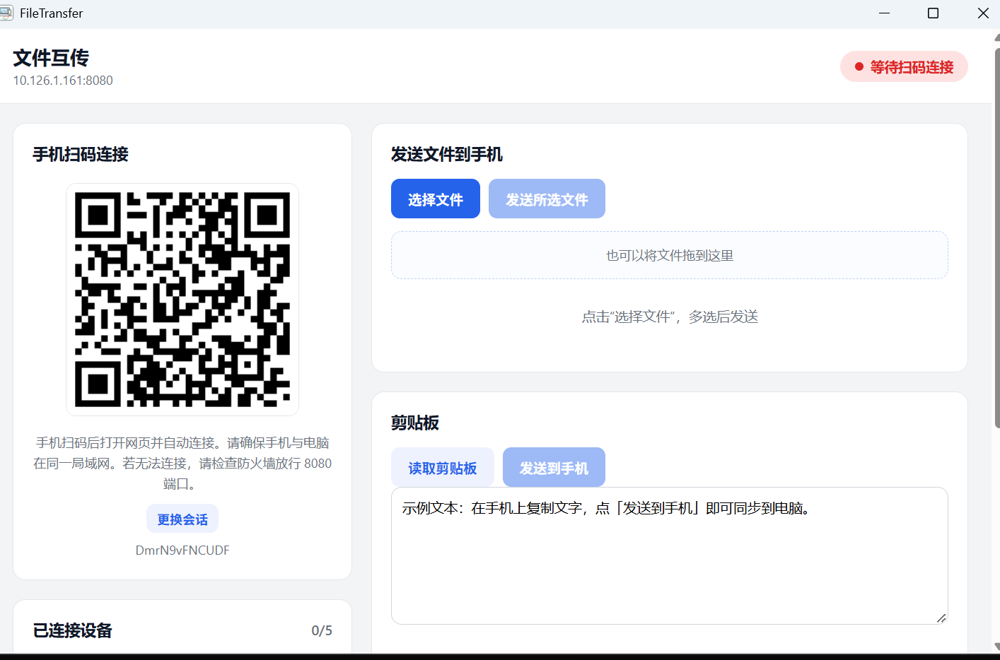

# 文件互传 · FileTransfer

A lightweight LAN-only file and clipboard transfer tool for phone ↔ PC. Start the desktop app, scan the QR code with your phone, and send files or clipboard content over your local network — no account, no cloud, no mobile app.

这是一个局域网内的手机 ↔ 电脑互传工具：电脑端显示二维码，手机扫码打开网页即可传文件、传照片、同步剪贴板。数据只在同一局域网内流动，不经过任何服务器。

> 本项目是 [RedStoneGuo/Drop_App](https://github.com/RedStoneGuo/Drop_App)（MIT）的衍生版本，在其基础上修复了传输可靠性问题并做了安全加固。

## 功能

- **扫码连接**：启动后显示二维码，手机扫码即用，无需安装手机 App
- **电脑 → 手机**：选择或拖入文件，分块传输，手机浏览器直接下载
- **手机 → 电脑**：手机网页选择文件上传，自动保存到指定目录
- **原图传输**：照片按原始字节传输，**不做任何压缩、缩放或转码**
- **剪贴板双向同步**：文本和图片双向发送；文字支持边打边同步
- **传输确认**：电脑保存成功/失败会回传手机，不再「发完就显示成功」
- **传输进度**：双向显示百分比进度
- **断线重连**：手机端指数退避自动重连
- **多设备并发**：同一台电脑最多同时连接 5 台手机/平板，可逐台勾选发送目标、单独断开；收发与剪贴板按设备隔离
- **日志面板**：桌面端可直接查看最近运行日志
- **单实例运行**：重复启动只会激活已有窗口，避免端口冲突
- **端口自动顺延**：8080 被占用时自动尝试 8081–8099，二维码始终显示真实端口

## 截图



## 下载

前往 [Releases](https://github.com/shoucunren-tsy/FileTransfer/releases) 下载 Windows 安装包（MSI / NSIS）。

> 安装包未做代码签名，Windows SmartScreen 可能提示「未知发布者」。这是未签名开源软件的常见现象，可点「更多信息 → 仍要运行」。

## 从源码构建

### 环境要求

**Windows**
- Windows 10/11（系统自带 WebView2）
- Rust stable **MSVC** 工具链
- Visual Studio Build Tools 2022，勾选「使用 C++ 的桌面开发」
- Node.js 18+

**macOS**
- macOS 12+
- Xcode Command Line Tools（`xcode-select --install`）
- Rust stable
- Node.js 18+

### 构建步骤

```bash
npm install
npm run tauri build
```

Windows 产物：`src-tauri/target/release/bundle/msi/`、`nsis/`
macOS 产物：`src-tauri/target/release/bundle/macos/`、`dmg/`

> **重要**：请用 `npm run tauri build` 构建。它会自动带上 `custom-protocol` feature；直接 `cargo build --release` 会把程序打成开发模式，运行时界面显示 `ERR_CONNECTION_REFUSED`。
>
> Windows 必须使用 MSVC 工具链：`rustup toolchain install stable-x86_64-pc-windows-msvc`。

### 开发运行

```bash
npm run dev        # 前端静态服务器 http://localhost:1420
npm run tauri dev  # 开发模式运行桌面应用
```

## 使用说明

1. 启动 FileTransfer，左侧显示二维码和地址（如 `http://192.168.1.5:8080/?session=xxxx`）
2. 手机与电脑连接同一 Wi-Fi / 局域网，扫码打开网页
3. 手机页面自动连接，电脑右上角显示「已连接设备」
4. 传文件：
   - 电脑 → 手机：选择文件或拖入列表 → 「发送所选文件」
   - 手机 → 电脑：点「传照片 / 视频」或「传其他文件」→ 「发送到电脑」
5. 多台设备：在左侧「已连接设备」勾选要发送的目标，未勾选时不会发送；可单台「断开」
6. 剪贴板：电脑端可读取系统剪贴板发送，也可直接输入文字；手机端可获取电脑剪贴板或粘贴内容发回
7. 连接异常时手机端自动重连；电脑端可点「更换会话」使旧二维码立即失效（所有设备下线）

> 手机打不开页面时：确认同一局域网；关闭 VPN、访客 Wi-Fi 和路由器的 AP 隔离；Windows 上允许防火墙放行 TCP 8080–8099。

## 架构

```
├── src/                     # 桌面端前端（原生 HTML/CSS/JS，无框架、无打包器）
├── dist/                    # 构建产物（npm run build 由 src 生成，不入库）
├── src-tauri/
│   ├── src/
│   │   ├── lib.rs           # 应用入口、插件与命令注册
│   │   ├── server.rs        # warp HTTP/WebSocket 服务、会话校验、消息转发
│   │   ├── files.rs         # 分块收发、落盘、目录选择、日志读取
│   │   ├── session.rs       # 会话 ID、局域网 IP 探测
│   │   └── state.rs         # 共享状态、传输状态、路径授权
│   ├── mobile/              # 手机端网页，编译期内嵌进二进制
│   └── tauri.conf.json
├── scripts/                 # 零依赖构建与开发服务器
└── docs/screenshots/        # 截图
```

传输协议：WebSocket 文本帧 + JSON。文件按 512 KiB 分块、Base64 编码后传输；手机 → 电脑方向带分块序号校验，接收端按声明大小校验字节数后才落盘。

## 安全模型与威胁边界

- **仅局域网**：服务监听 `0.0.0.0`，供同一局域网访问；不做公网映射、不依赖云服务
- **会话即凭证**：12 位随机会话 ID 同时用于页面访问和 WebSocket 握手；每次启动、点击「更换会话」都会更新。拿到完整二维码链接的人即可连接
- **明文传输**：HTTP / WS 未加密。**请勿在公共 / 不可信 Wi-Fi 使用**，同网段的其他设备理论上可以嗅探流量
- **多设备上限**：同一时间最多接受 5 台设备，超出会被明确拒绝；同一 IP + 同名设备视为重连，新页面会替换旧页面
- **最小文件权限**：电脑端只读取用户通过文件对话框或拖拽明确选择的路径；接收端清洗文件名、限制 5 GiB、校验分块顺序与总字节数
- **WebView 加固**：桌面端启用 CSP；手机页面带 `nosniff`、`no-referrer`、`no-store` 与 CSP 响应头
- **剪贴板限制**：文本单次上限 1 MiB，图片写入系统临时目录并在 10 分钟后清理

## 已知限制

- **手机锁屏/切后台会中断连接**：系统可能冻结网页并挂起网络，网页无法阻止。解锁返回后会自动重连（通常 1–3 秒），无需重新扫码；锁屏期间正在进行的传输会失败，需重新发送
- **大文件受手机内存限制**：电脑 → 手机方向在手机端用 Blob 拼接，数百 MB 以上可能失败；建议日常传输控制在几十 MB 内
- Base64 编码带来约 33% 的传输开销
- 无断点续传；传输中断需重新发送
- 同一时间最多 5 台设备；发送大文件时按设备串行，不并行广播
- 传输过程中关闭程序可能留下 `.part` 临时文件，下次启动自动清理
- 未签名安装包可能触发 SmartScreen 提示
- Windows 防火墙规则为尽力而为：便携运行时若没有管理员权限，需要手动放行端口

## 路线图

- [ ] 流式下载，解除手机内存限制
- [ ] 断点续传
- [x] 多设备并发（0.2.0 已实现，上限 5 台）
- [ ] 可选的局域网加密（如基于一次性口令的 TLS）

## 项目来源与致谢

- 上游项目：[RedStoneGuo/Drop_App](https://github.com/RedStoneGuo/Drop_App)（MIT License）
- 二维码生成：[qrcode-generator](https://github.com/kazuhikoarase/qrcode-generator)，作者 Kazuhiko Arase（MIT License）

## 许可证

本项目以 [MIT License](LICENSE) 发布。原始代码版权归 RedStoneGuo 所有，本版本新增与修改部分的版权归 Shoucunren and contributors 所有。
